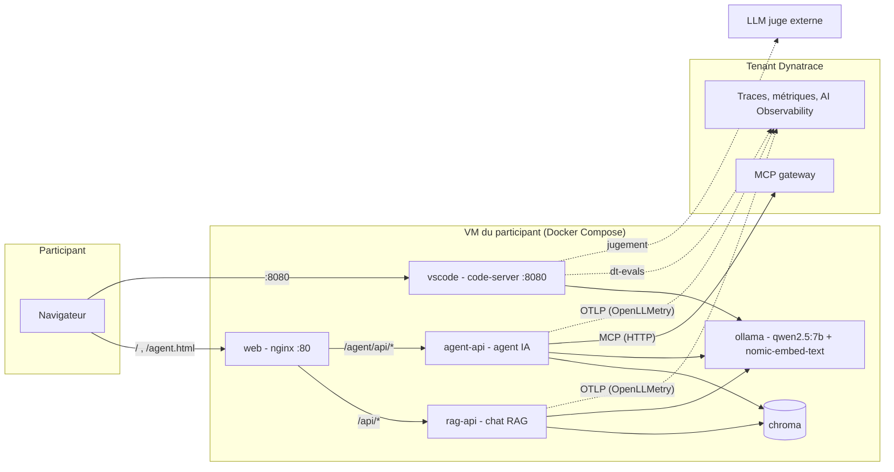
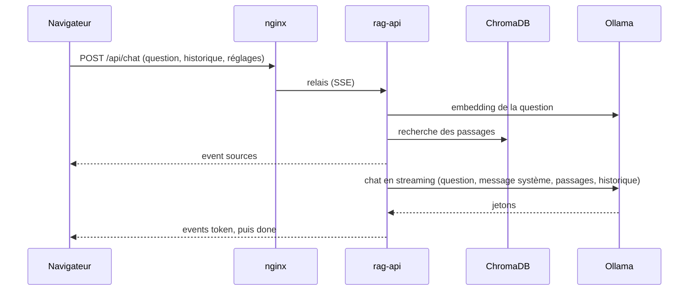

# Architecture de l'environnement de formation

[English version](ARCHITECTURE.md)

Document destiné aux formateurs et aux mainteneurs. Il décrit ce qui est déployé, comment les composants communiquent, comment la
télémétrie est produite et où se règle chaque comportement. Les exercices sont dans `stack/exercices/README.fr.md`.

## 1. Vue d'ensemble

Chaque participant reçoit **sa propre VM** Azure (Ubuntu 22.04, `Standard_B12ms`, 12 vCPU, 48 Go, sans GPU). Sur cette VM, une pile
Docker Compose fait tourner un modèle local (Ollama), une application de chat RAG, une application d'agent IA et un VS Code dans le
navigateur. Les applications envoient leur télémétrie (OpenLLMetry) au tenant Dynatrace de la formation.



Trois couches :
1. **Déploiement** (poste du formateur) : scripts Azure CLI qui créent N VM en parallèle.
2. **Pile applicative** (par VM) : sept conteneurs, décrits en section 4.
3. **Dynatrace** : ingestion OTLP, AI Observability, serveur MCP, évaluations.

## 2. Technologies utilisées

### Plateforme et déploiement
| Technologie | Usage |
|---|---|
| Microsoft Azure, Azure CLI, modèle ARM | Création des VM, de l'IP publique, du réseau et du groupe de sécurité ; `az vm run-command` pour installer la pile |
| Ubuntu 22.04 (`Standard_B12ms`, CPU seul) | Système des VM |
| Docker et Docker Compose | Exécution de la pile de sept conteneurs |
| Bash | Scripts de déploiement, d'installation, d'activation d'OpenLLMetry et de génération de trafic |

### Modèles d'IA
| Technologie | Usage |
|---|---|
| Ollama | Serveur de modèles local (API de chat, d'embedding, appels d'outils) |
| `qwen2.5:7b` | Modèle de génération et d'appel d'outils (CPU, quelques jetons par seconde) |
| `nomic-embed-text` | Modèle d'embedding des documents et des questions |
| ChromaDB 0.6.3 | Base vectorielle (RAG), similarité cosinus |

### Backend (image Python 3.11 partagée par le chat et l'agent)
| Technologie | Usage |
|---|---|
| Python 3.11 (`python:3.11-slim`) | Langage des deux API |
| FastAPI, Uvicorn, Pydantic | API HTTP, validation des requêtes, réponses en streaming (SSE) |
| `ollama` (client Python) | Appels asynchrones au modèle et aux embeddings |
| `chromadb` (client), NumPy < 2 | Accès à la base vectorielle |
| `pypdf`, `python-multipart` | Extraction du texte des PDF, envoi de fichiers |
| `mcp` (SDK Python, version 1.x) | Client du protocole MCP (Streamable HTTP) |
| `asyncio` | Concurrence, file d'événements entre l'agent et la réponse HTTP |

### Agent IA (aucun framework d'agent)
L'agent est écrit à la main en Python : il n'utilise ni LangChain, ni LangGraph, ni CrewAI. La boucle tient en une soixantaine de lignes
dans `agent.py`.

| Technologie | Usage |
|---|---|
| `qwen2.5:7b` via Ollama | Raisonnement et choix des outils, avec l'appel d'outils natif d'Ollama (définitions en JSON schema passées à `chat`) |
| Python 3.11 et `asyncio` | Boucle de l'agent : appel au modèle, exécution des outils demandés, ajout des résultats, nouvel appel, nombre d'étapes maximal |
| Sous-agent Dynatrace | La même boucle, appelée comme un outil (`ask_dynatrace`) avec sa propre instruction et son propre contexte |
| FastAPI, Server-Sent Events, `asyncio.Queue` | API de l'agent et diffusion des étapes vers le navigateur |
| SDK `mcp` (1.x), Streamable HTTP | Outils de la passerelle MCP de Dynatrace |
| Sous-processus sans shell, liste blanche | Outil `dtctl` en lecture seule |
| Lecture de fichiers `SKILL.md` | Skills chargées à la demande |
| `ast` (bibliothèque standard) | Outil de calcul : expression arithmétique analysée et évaluée sans `eval` |
| OpenLLMetry (`@agent`, `@task`, `@tool`) | Un span par étape et par outil |

Un framework donnerait de la mémoire, des graphes d'états et des reprises sur erreur prêts à l'emploi, que l'atelier n'utilise pas. Le
choix d'une boucle écrite à la main garde le code lisible en un seul fichier, permet aux participants d'y ajouter un outil (exercice F3) et
fait de chaque étape et de chaque outil un span directement, sans couche intermédiaire.

### Observabilité et évaluation
| Technologie | Usage |
|---|---|
| OpenLLMetry (SDK Traceloop `traceloop-sdk`) | Instrumentation GenAI : décorateurs `@workflow`, `@task`, `@agent`, `@tool` et instrumentation Ollama |
| OpenTelemetry (OTLP/HTTP) | Format et transport des traces et des métriques vers Dynatrace |
| Dynatrace : traces distribuées, AI Observability, Grail et DQL | Visualisation, requêtes et tableaux de bord |
| Dynatrace MCP (passerelle `mcp-gateway`) | Outils d'accès à la plateforme pour l'agent |
| dtctl (Dynatrace CLI) | Outil en ligne de commande, en lecture seule, pour l'agent |
| Skills Dynatrace (`dynatrace-for-ai`, fichiers `SKILL.md`) | Connaissance chargée à la demande par le sous-agent |
| dt-evals (Node.js 20) | Évaluation par LLM juge des spans GenAI (OpenAI, Anthropic, Gemini/Vertex, Bedrock, Azure OpenAI) |

### Interface web et outils de développement
| Technologie | Usage |
|---|---|
| nginx (`nginx:alpine`) | Fichiers statiques et reverse proxy, streaming SSE |
| HTML, CSS et JavaScript natifs | Pages de chat et d'agent, sans framework ni étape de compilation |
| Server-Sent Events | Diffusion des jetons, des étapes de l'agent et des appels d'outils |
| SVG, `localStorage`, `sessionStorage` | Drapeaux des langues, mémorisation des réglages et de la conversation |
| code-server (VS Code dans le navigateur) | Poste de travail des participants |
| Continue (extension VS Code) | Chat sur le modèle local, via Ollama |
| Node.js 20, git | Pour dt-evals et pour récupérer les skills |
| Mermaid | Schémas de ce document |

## 3. Déploiement

| Élément | Rôle |
|---|---|
| `azure-cli-deploy-vm-for-training-ai.sh` | Menu interactif (nombre de VM, mot de passe, OpenLLMetry, tenant, token, clé du juge), puis déploiement. |
| `env.sh` | Valeurs par défaut (taille, régions, modèles, juge). Les choix du menu sont mémorisés dans `.lab-config`. |
| `azuredeploy-ubuntu22.json` | Modèle ARM : VM, IP publique statique avec nom DNS, réseau virtuel, groupe de sécurité réseau (ports **22, 80, 8080**). |
| `vm-setup.sh` | Exécuté en root sur la VM via `az vm run-command` : installe Docker, déploie la pile, attend les modèles et l'indexation. |

Déroulé : le script crée un groupe de ressources par VM (nom `<formation><NN>`, 5 VM par région pour respecter les quotas :
francecentral, westeurope, northeurope, uksouth), déploie le modèle ARM, puis envoie à la VM un script autonome qui embarque
`lab.env` (configuration), l'archive de `stack/` (encodée en base64, sans `.env` ni `__pycache__`) et `vm-setup.sh`. `vm-setup.sh`
écrit `stack/.env`, lance `docker compose up -d --build` et attend `"ready": true` sur `/api/health`. Les VM sont ensuite libérées
(deallocate) sauf si l'option « VM démarrée » est choisie ; la pile redémarre avec la VM.

Le numéro de VM (suffixe du nom d'hôte, par exemple `aitraining03`) sert à nommer les services Dynatrace : `ai-lab-rag-api-03`,
`ai-lab-agent-api-03`.

## 4. Pile applicative d'une VM

| Service | Image / source | Port (hôte) | Rôle | Montages notables |
|---|---|---|---|---|
| `ollama` | `ollama/ollama` | interne | Sert `qwen2.5:7b` (génération, appels d'outils) et `nomic-embed-text` (embeddings). Modèles gardés 24 h en mémoire. | volume `ollama_data` |
| `ollama-init` | `ollama/ollama` | — | Tâche unique : télécharge les deux modèles. | — |
| `chroma` | `chromadb/chroma:0.6.3` | interne | Base vectorielle persistante des passages de documents. | volume `chroma_data` |
| `rag-api` | `stack/rag-api` | interne | API du chat : indexation, recherche, prompt, streaming SSE. | `./docs` (lecture seule) |
| `agent-api` | même image que `rag-api` (commande `app.agent_main`) | interne | API de l'agent : boucle d'outils, sous-agent Dynatrace, MCP, dtctl, skills. | `./docs`, `./mcp`, `./skills` (lecture seule) |
| `web` | `nginx:alpine` | **80** | Sert les pages statiques et relaie les API. | `./web`, `nginx.conf` (lecture seule) |
| `vscode` | `stack/vscode` (code-server) | **8080** | VS Code web, chat Continue sur le modèle local, dtctl, Node.js, dt-evals, git. | `./` monté sur `/workspace` (lecture et écriture) |

Réseau : tous les conteneurs partagent le réseau Compose par défaut ; seuls `web` (80) et `vscode` (8080) sont publiés. `nginx`
relaie `/api/` vers `rag-api:8000` et `/agent/api/` vers `agent-api:8000` (réécrit en `/api/`), avec le tamponnage désactivé pour le
streaming SSE et de longs délais (900 s et 1800 s) car l'inférence CPU est lente.

Dossiers partagés (tout `stack/` est visible dans VS Code sous `/workspace`) :
`docs` (base de connaissances du chat), `mcp` (`mcp.json` et `dtctl-config` créés par les participants), `skills` (skills Dynatrace
choisies par les participants), `evals` (configuration de dt-evals), `exercices` (catalogue), `scripts` (activation d'OpenLLMetry, trafic).

## 5. Flux de requêtes

### 5.1 Chat RAG



`rag.build_messages` construit, dans cet ordre : la **question seule**, le **message système**, un message `user` avec les **passages RAG**
(préfixe `Passages de documents :`), un message `user` avec l'**historique** (préfixe `Échanges précédents :`). Cet ordre et ces préfixes
servent à l'observabilité (section 6.3). Ollama regroupe les messages `system` quelle que soit leur position.

### 5.2 Agent

L'agent est une boucle écrite à la main, sans framework d'agent (voir section 2). `agent-api` exécute une boucle (`agent.py`, fonction `loop`) : un appel au modèle avec les outils, exécution des appels d'outils demandés,
ajout des résultats, nouvel appel, jusqu'à une réponse sans outil ou jusqu'au nombre d'étapes maximal (la dernière étape n'a pas d'outils,
le modèle doit répondre). Les événements SSE portent un label `agent` (`main` ou `dynatrace`).

- **Outils locaux** : `search_documents` et `list_documents` (même base ChromaDB que le chat), `calculator` (évaluation arithmétique
  sécurisée par analyse syntaxique), `get_current_time`.
- **Sous-agent Dynatrace** : si un accès Dynatrace existe (serveur MCP déclaré, ou dtctl configuré), l'agent principal ne reçoit qu'un
  outil, `ask_dynatrace(question)`. Il délègue à un sous-agent avec sa propre instruction, son propre contexte (même taille de fenêtre),
  4 étapes au plus (`DT_AGENT_MAX_STEPS`) et seulement les outils Dynatrace : outils MCP, `dtctl`, `list_skills`/`read_skill`. Le
  sous-agent rend un résumé court. `MCP_SUBAGENT=false` donne ces outils directement à l'agent principal.
- **Contexte** : fenêtre de 8192 jetons (`AGENT_NUM_CTX`). Une alerte SSE `warning` est émise si Ollama coupe la génération
  (`done_reason=length`) ou si le prompt dépasse 90 % de la fenêtre.

### 5.3 Briques d'accès à Dynatrace (côté agent)

| Brique | Fichier | Fonctionnement |
|---|---|---|
| MCP | `mcp_tools.py` | Lit `/workspace/mcp/mcp.json` (format `servers` ou `mcpServers`), relu quand le fichier change ou après 60 s. Serveurs **distants** en HTTP (SDK `mcp` 1.x). Découverte des outils puis une session courte par appel d'outil. Liste d'outils autorisés facultative (`"tools"`), `${VAR}` remplacé par l'environnement. Un serveur en panne n'affecte pas les autres ; les erreurs 401/403 sont expliquées. |
| dtctl | `dtctl_tool.py` | Binaire installé dans l'image. Outil `dtctl(command)` exécuté sans shell, en mode `--agent` avec sortie bornée. **Liste blanche** : `query`, `get`, `describe`, `logs`, `inventory`, `commands`, `inspect`, `doctor`, `version`, `exec copilot nl2dql\|dql2nl`. Options bloquées : `--config`, `--context`, `--token`, `--environment`, `-f/--file`, `--watch`… Configuration lue dans `DTCTL_CONFIG`. |
| Skills | `skills.py` | Détecte les `SKILL.md` sous `/workspace/skills` (4 niveaux). Le sous-agent voit la liste courte (nom, description) dans son instruction et lit une skill à la demande avec `read_skill` (tronquée à `SKILL_MAX_CHARS`, références lisibles à part, sorties de dossier refusées). |

Les sorties d'outils sont compactées (JSON sans indentation) et plafonnées à `TOOL_RESULT_CHARS` (6000 caractères par défaut) pour protéger le contexte. Un résultat plus long est coupé et se termine par un marqueur qui prévient le modèle qu'il est incomplet : il redemande alors avec une requête plus précise au lieu de présenter une liste partielle comme complète.

## 6. Observabilité

### 6.1 Principe

Le SDK Traceloop (OpenLLMetry) est initialisé **avant** l'import d'`ollama` et `chromadb` (`telemetry.py`, fonction `init_telemetry`),
conformément à la documentation Dynatrace : `Traceloop.init` vers `https://<tenant>/api/v2/otlp`, `disable_batch=True`, temporalité des
métriques `delta`. Seule l'instrumentation **Ollama** est active (ChromaDB et HTTP sont exclus). L'en-tête d'authentification est
`Api-Token` pour un token classique (`dt0c01.*`), `Bearer` sinon. Sans `OPENLLMETRY_ENABLED=true` (ou tenant ou token absent), aucune
télémétrie n'est émise et les décorateurs ne font rien.

### 6.2 Structure des traces

```
Chat   (service ai-lab-rag-api-NN)
  rag.chat                      @workflow   entrée : la question, sortie : la réponse
  ├─ rag.retrieve               @task       (appel d'embedding Ollama dedans)
  └─ rag.generate               @task       (appel de chat Ollama dedans)

Agent  (service ai-lab-agent-api-NN)
  agent.run                     @agent      entrée : la tâche, sortie : la réponse finale
  ├─ agent.step                 @task       un appel au modèle (span LLM dedans)
  ├─ <outil local>              @tool       calculator, search_documents, ...
  └─ ask_dynatrace              @tool       délégation au sous-agent
     └─ dynatrace_agent         @agent
        ├─ agent.step           @task       (span LLM dedans)
        └─ <outil MCP | dtctl | read_skill>  @tool
```

Les spans « appel au modèle » viennent de l'instrumentation Ollama (modèle, réglages, jetons d'entrée, de sortie et total, streaming,
prompt et réponse). Les fonctions décorées sont des fonctions `async` simples, non des générateurs, avec des arguments minimaux : les
événements SSE destinés au navigateur circulent par une `asyncio.Queue`, et chaque requête s'exécute dans sa propre tâche pour éviter
les fuites de contexte de trace.

### 6.3 Ce qui est exporté du prompt

Un callback `span_postprocess_callback` (`_strip_history`) retire du span LLM, juste avant l'export, les messages commençant par les
préfixes `Échanges précédents :` (historique, toujours) et `Passages de documents :` (RAG, sauf si `OPENLLMETRY_KEEP_RAG=true`). Il gère
les deux formes d'attributs de l'instrumentation (`gen_ai.prompt.N.*` et `gen_ai.input.messages`). Les compteurs de jetons ne sont pas
modifiés. C'est le seul écart avec une configuration OpenLLMetry standard ; il modifie un attribut privé d'OpenTelemetry que le SDK
déverrouille explicitement pour ce cas. `OPENLLMETRY_TRACE_CONTENT=false` supprime tout le texte des prompts et des réponses.

### 6.4 Activation et évaluation

| Besoin | Mécanisme |
|---|---|
| Activer le chat | `scripts/set-openllmetry.sh on <tenant> <token>` (ou option au déploiement) |
| Activer l'agent seul | `scripts/set-agent-openllmetry.sh on <tenant> <token>` (sinon l'agent suit l'option du chat) |
| Garder les passages RAG | `scripts/set-rag-context.sh on` |
| Juger les réponses | `dt-evals` dans le terminal VS Code : lit les spans du service, appelle un LLM juge externe (clé partagée), écrit des bizevents `gen_ai.evaluation.result` visibles dans AI Observability > Evaluations |

Le LLM juge n'est jamais le modèle local : dt-evals ne documente que OpenAI, Anthropic, Gemini/Vertex, Bedrock et Azure OpenAI.

## 7. Interface web

Pages statiques servies par nginx, sans framework :

| Fichier | Rôle |
|---|---|
| `index.html` | Chat : réglages, documents, passages cités, onglet Observability (code de `telemetry.py`). Contient son propre JavaScript et ses textes. |
| `agent.html` | Agent : étapes, cartes d'outils, sous-agent imbriqué dans la carte `ask_dynatrace`, onglets Paramètres, Outils (état MCP, dtctl, skills) et Observability. |
| `common.css` | Styles partagés par les deux pages (thème clair/sombre, sélecteur de langue, navigation). |
| `common.js` | Utilitaires de la page agent : drapeaux, sélecteur de langue, rendu markdown minimal, fabrique de traductions. |

Fonctionnement :
- **Langues** : français, anglais, espagnol, allemand, italien, avec drapeaux en SVG. Le choix est mémorisé (`localStorage`, clé
  commune aux deux pages). Les messages système par défaut sont fournis par le serveur dans les cinq langues et suivent la langue tant
  que le participant ne les a pas modifiés.
- **Conservation de la conversation** : chaque page enregistre ses échanges dans `sessionStorage` (30 pour le chat, 20 pour l'agent) et les
  réaffiche au retour. La page agent rejoue les événements enregistrés avec le même code que l'affichage en direct.
- **Protocole SSE du chat** : `sources`, `token`, `done` (jetons, débit, durée), `error`.
- **Protocole SSE de l'agent** : `step`, `token`, `tool_call`, `tool_result`, `warning`, `done`, `error`, chacun avec le champ `agent`.
- **Statuts** : pastilles modèle, documents ou outils, OpenLLMetry et dtctl, rafraîchies toutes les 5 secondes via `/api/health`.
- L'onglet Observability masque l'interface de chat (la règle CSS `.chat[hidden]` est nécessaire car `.chat` est en `display: flex`).

## 8. Configuration : où régler quoi

| Variable | Service | Effet |
|---|---|---|
| `OPENLLMETRY_ENABLED`, `AGENT_OPENLLMETRY_ENABLED` | chat, agent | active OpenLLMetry (l'agent suit le chat par défaut) |
| `DT_TENANT`, `DT_API_TOKEN` | chat, agent | endpoint OTLP et token d'ingestion |
| `OTEL_SERVICE_NAME`, `AGENT_OTEL_SERVICE_NAME` | chat, agent | nom de base du service (le numéro de VM est ajouté) |
| `OPENLLMETRY_TRACE_CONTENT` | chat, agent | texte des prompts et réponses dans les traces |
| `OPENLLMETRY_KEEP_RAG` | chat, agent | garde les passages RAG dans les traces |
| `LLM_MODEL`, `EMBED_MODEL` | tous | modèles Ollama |
| `AGENT_NUM_CTX` | agent | fenêtre de contexte (8192 par défaut) |
| `TOOL_RESULT_CHARS` | agent | taille maximale d'un résultat d'outil donné au modèle (6000 caractères par défaut) |
| `MCP_SUBAGENT`, `DT_AGENT_MAX_STEPS` | agent | sous-agent Dynatrace et son nombre d'étapes |
| `MCP_CONFIG`, `DTCTL_CONFIG`, `DTCTL_CONTEXT`, `SKILLS_DIR`, `SKILL_MAX_CHARS` | agent | emplacement des fichiers des participants |
| `DOCS_LANG` | chat | langue des documents de la base de connaissances : `en` (par défaut, fichiers `*.md`) ou `fr` (fichiers `*.fr.md`) |
| `VSCODE_PASSWORD` | vscode | mot de passe de VS Code web (celui de la VM) |
| `JUDGE_PROVIDER`, `JUDGE_MODEL`, `JUDGE_API_KEY` | vscode | juge de dt-evals (la clé est exposée sous le nom attendu par le fournisseur) |

Les valeurs vont dans `stack/.env` (écrit par `vm-setup.sh`, mode 600) ; `stack/.env.example` en donne un exemple.

## 9. Sécurité et limites connues

- **Ports** : 22, 80 et 8080 ouverts, en HTTP simple (le mot de passe VS Code et les conversations circulent en clair).
- **Secrets** : le token d'ingestion est dans `.env` ; `mcp.json` et `dtctl-config` (créés par les participants) peuvent contenir des tokens,
  ils sont ignorés par git ; la clé du juge est visible dans le terminal des participants (à plafonner et révoquer).
- **VS Code** : le conteneur tourne en root avec tout `stack/` en écriture ; quiconque a le mot de passe contrôle ce dossier.
- **dtctl** : le niveau `readonly` est appliqué côté client seulement ; la protection réelle est un token à droits de lecture minimaux.
  L'agent ajoute sa propre liste blanche de commandes.
- **MCP** : l'accès se limite aux outils déclarés dans `mcp.json` (liste facultative) et aux droits du token.
- **Modèle** : un modèle de 7 milliards de paramètres sur CPU est lent (réponses en secondes à minutes) et choisit moins bien ses outils
  quand ils sont nombreux ; d'où le sous-agent, la liste d'outils autorisés et la fenêtre de contexte élargie.
- **Évaluation** : le contenu des traces évaluées part chez le fournisseur du juge (dt-evals masque d'abord e-mails, téléphones, cartes,
  numéros de sécurité sociale).
- **Indexation** : les documents ne sont indexés qu'au premier démarrage ; après modification de `docs/`, utiliser « Réindexer les exemples ».

## 10. Choix de conception

| Choix | Raison |
|---|---|
| Une VM par participant | Isolation, mesures de performance indépendantes, services Dynatrace par participant. |
| Même image pour `rag-api` et `agent-api` | Partage de `rag.py`, `telemetry.py`, des dépendances ; deux services pour deux noms de service OpenLLMetry. |
| Question d'abord, contexte ensuite | Dynatrace affiche le premier message d'entrée : la question doit être lisible, sans historique ni passages. |
| Callback de masquage plutôt que traçage manuel | Reste dans OpenLLMetry ; le span LLM reste produit par le SDK. |
| Fonctions simples + file d'attente pour le streaming | Les spans commencent et finissent proprement ; pas de fuite de contexte entre `yield`. |
| Boucle d'agent écrite à la main, sans framework | Code lisible en un fichier, outil ajoutable par les participants, chaque étape et chaque outil devient un span sans couche intermédiaire. Limites assumées : pas de mémoire longue (6 derniers messages), pas de planification explicite, choix des outils laissé au modèle. |
| Sous-agent Dynatrace | Isole les schémas et résultats volumineux, réduit le nombre d'outils vus par le modèle principal, bonne démonstration multi-agents. |
| Configuration par fichiers des participants (`mcp.json`, `dtctl-config`, skills) | Ce sont les exercices : les participants créent eux-mêmes les intégrations, avec rechargement automatique. |
| Pages sans framework | Aucun outil de build, fichiers montés en lecture seule, modifiables sur la VM. |

## 11. Plan des fichiers

```
azure-cli-deploy-vm-for-training-ai.sh   déploiement (menu, ARM, run-command)
azuredeploy-ubuntu22.json                modèle ARM
env.sh  vm-setup.sh                      valeurs par défaut, installation sur la VM
ARCHITECTURE.fr.md  README.md               ce document, présentation
stack/
  docker-compose.yml  nginx.conf  .env.example
  rag-api/                               image Python partagée par le chat et l'agent
    app/main.py  rag.py                  chat RAG
    app/agent.py  agent_main.py          agent, boucle, sous-agent, API de l'agent
    app/mcp_tools.py  dtctl_tool.py  skills.py   outils Dynatrace
    app/telemetry.py                     OpenLLMetry, décorateurs, callback de masquage
  vscode/                                code-server, entrypoint (Continue, dt-evals)
  web/  index.html agent.html common.css common.js
  docs/                                  base de connaissances du chat (indexée)
  mcp/  skills/  evals/                  espaces de travail des participants
  exercices/                             catalogue des exercices
  scripts/                               OpenLLMetry (chat, agent), contexte RAG, trafic
```
