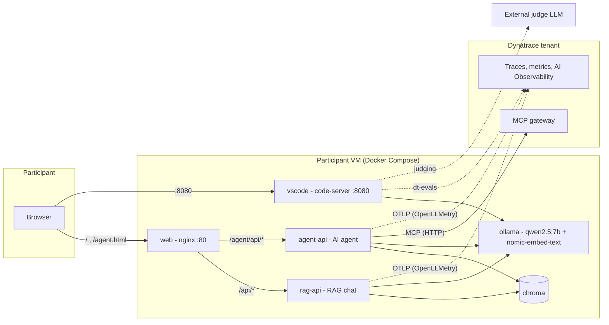
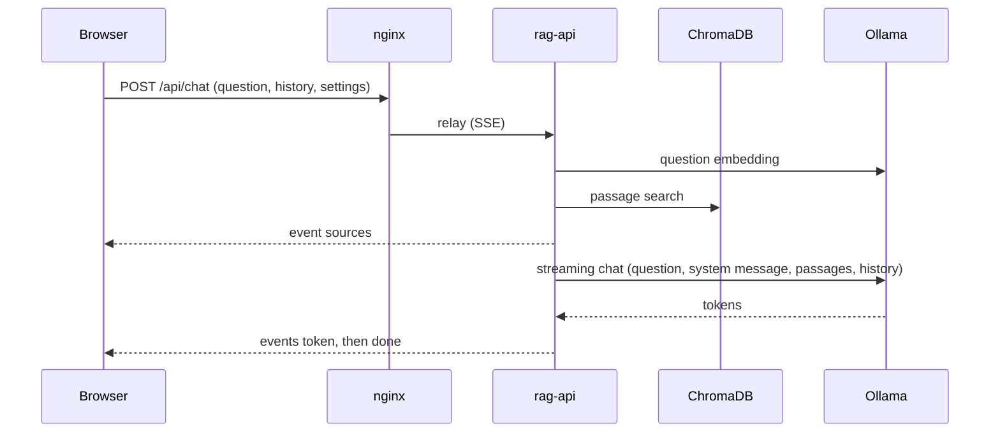

# Training environment architecture

[Version française](ARCHITECTURE.fr.md)

Document intended for trainers and maintainers. It describes what is deployed, how the components communicate, how the
telemetry is produced and where each behavior is configured. The exercises are in `stack/exercices/README.md`.

## 1. Overview

Each participant receives **their own** Azure VM (Ubuntu 22.04, `Standard_B12ms`, 12 vCPU, 48 GB, no GPU). On this VM, a Docker
Compose stack runs a local model (Ollama), a RAG chat application, an AI agent application and a VS Code in the
browser. The applications send their telemetry (OpenLLMetry) to the training's Dynatrace tenant.



Three layers:
1. **Deployment** (trainer's workstation): Azure CLI scripts that create N VMs in parallel.
2. **Application stack** (per VM): seven containers, described in section 4.
3. **Dynatrace**: OTLP ingestion, AI Observability, MCP server, evaluations.

## 2. Technologies used

### Platform and deployment
| Technology | Usage |
|---|---|
| Microsoft Azure, Azure CLI, ARM template | Creation of the VMs, public IP, network and security group; `az vm run-command` to install the stack |
| Ubuntu 22.04 (`Standard_B12ms`, CPU only) | VM operating system |
| Docker and Docker Compose | Running the seven-container stack |
| Bash | Deployment, installation, OpenLLMetry activation and traffic generation scripts |

### AI models
| Technology | Usage |
|---|---|
| Ollama | Local model server (chat API, embedding API, tool calls) |
| `qwen2.5:7b` | Generation and tool-calling model (CPU, a few tokens per second) |
| `nomic-embed-text` | Embedding model for documents and questions |
| ChromaDB 0.6.3 | Vector database (RAG), cosine similarity |

### Backend (Python 3.11 image shared by the chat and the agent)
| Technology | Usage |
|---|---|
| Python 3.11 (`python:3.11-slim`) | Language of both APIs |
| FastAPI, Uvicorn, Pydantic | HTTP API, request validation, streaming responses (SSE) |
| `ollama` (Python client) | Asynchronous calls to the model and to the embeddings |
| `chromadb` (client), NumPy < 2 | Access to the vector database |
| `pypdf`, `python-multipart` | PDF text extraction, file upload |
| `mcp` (Python SDK, version 1.x) | MCP protocol client (Streamable HTTP) |
| `asyncio` | Concurrency, event queue between the agent and the HTTP response |

### AI agent (no agent framework)
The agent is hand-written in Python: it uses neither LangChain, nor LangGraph, nor CrewAI. The loop fits in about sixty lines
in `agent.py`.

| Technology | Usage |
|---|---|
| `qwen2.5:7b` via Ollama | Reasoning and tool selection, with Ollama's native tool calling (JSON schema definitions passed to `chat`) |
| Python 3.11 and `asyncio` | Agent loop: model call, execution of the requested tools, adding the results, new call, maximum number of steps |
| Dynatrace sub-agent | The same loop, called as a tool (`ask_dynatrace`) with its own instruction and its own context |
| FastAPI, Server-Sent Events, `asyncio.Queue` | Agent API and streaming of the steps to the browser |
| `mcp` SDK (1.x), Streamable HTTP | Tools of the Dynatrace MCP gateway |
| Subprocess without shell, allowlist | Read-only `dtctl` tool |
| Reading `SKILL.md` files | Skills loaded on demand |
| `ast` (standard library) | Calculator tool: arithmetic expression parsed and evaluated without `eval` |
| OpenLLMetry (`@agent`, `@task`, `@tool`) | One span per step and per tool |

A framework would provide memory, state graphs and error recovery out of the box, which the workshop does not use. Choosing a
hand-written loop keeps the code readable in a single file, lets participants add a tool to it (exercise F3) and
turns each step and each tool directly into a span, without an intermediate layer.

### Observability and evaluation
| Technology | Usage |
|---|---|
| OpenLLMetry (Traceloop SDK `traceloop-sdk`) | GenAI instrumentation: `@workflow`, `@task`, `@agent`, `@tool` decorators and Ollama instrumentation |
| OpenTelemetry (OTLP/HTTP) | Format and transport of traces and metrics to Dynatrace |
| Dynatrace: distributed traces, AI Observability, Grail and DQL | Visualization, queries and dashboards |
| Dynatrace MCP (`mcp-gateway` gateway) | Platform access tools for the agent |
| dtctl (Dynatrace CLI) | Read-only command-line tool for the agent |
| Dynatrace skills (`dynatrace-for-ai`, `SKILL.md` files) | Knowledge loaded on demand by the sub-agent |
| dt-evals (Node.js 20) | LLM-judge evaluation of GenAI spans (OpenAI, Anthropic, Gemini/Vertex, Bedrock, Azure OpenAI) |

### Web interface and development tools
| Technology | Usage |
|---|---|
| nginx (`nginx:alpine`) | Static files and reverse proxy, SSE streaming |
| Native HTML, CSS and JavaScript | Chat and agent pages, without framework or build step |
| Server-Sent Events | Streaming of tokens, agent steps and tool calls |
| SVG, `localStorage`, `sessionStorage` | Language flags, saving of settings and of the conversation |
| code-server (VS Code in the browser) | Participants' workstation |
| Continue (VS Code extension) | Chat on the local model, via Ollama |
| Node.js 20, git | For dt-evals and for fetching the skills |
| Mermaid | Diagrams of this document |

## 3. Deployment

| Element | Role |
|---|---|
| `azure-cli-deploy-vm-for-training-ai.sh` | Interactive menu (number of VMs, password, OpenLLMetry, tenant, token, judge key), then deployment. |
| `env.sh` | Default values (size, regions, models, judge). The menu choices are saved in `.lab-config`. |
| `azuredeploy-ubuntu22.json` | ARM template: VM, static public IP with DNS name, virtual network, network security group (ports **22, 80, 8080**). |
| `vm-setup.sh` | Run as root on the VM via `az vm run-command`: installs Docker, deploys the stack, waits for the models and the indexing. |

Flow: the script creates one resource group per VM (name `<training><NN>`, 5 VMs per region to respect the quotas:
francecentral, westeurope, northeurope, uksouth), deploys the ARM template, then sends the VM a standalone script that embeds
`lab.env` (configuration), the `stack/` archive (base64-encoded, without `.env` or `__pycache__`) and `vm-setup.sh`. `vm-setup.sh`
writes `stack/.env`, runs `docker compose up -d --build` and waits for `"ready": true` on `/api/health`. The VMs are then released
(deallocate) unless the "VM started" option is chosen; the stack restarts with the VM.

The VM number (suffix of the host name, for example `aitraining03`) is used to name the Dynatrace services: `ai-lab-rag-api-03`,
`ai-lab-agent-api-03`.

## 4. Application stack of a VM

| Service | Image / source | Port (host) | Role | Notable mounts |
|---|---|---|---|---|
| `ollama` | `ollama/ollama` | internal | Serves `qwen2.5:7b` (generation, tool calls) and `nomic-embed-text` (embeddings). Models kept in memory for 24 h. | volume `ollama_data` |
| `ollama-init` | `ollama/ollama` | — | One-shot task: downloads the two models. | — |
| `chroma` | `chromadb/chroma:0.6.3` | internal | Persistent vector database of the document passages. | volume `chroma_data` |
| `rag-api` | `stack/rag-api` | internal | Chat API: indexing, search, prompt, SSE streaming. | `./docs` (read-only) |
| `agent-api` | same image as `rag-api` (command `app.agent_main`) | internal | Agent API: tool loop, Dynatrace sub-agent, MCP, dtctl, skills. | `./docs`, `./mcp`, `./skills` (read-only) |
| `web` | `nginx:alpine` | **80** | Serves the static pages and relays the APIs. | `./web`, `nginx.conf` (read-only) |
| `vscode` | `stack/vscode` (code-server) | **8080** | Web VS Code, Continue chat on the local model, dtctl, Node.js, dt-evals, git. | `./` mounted on `/workspace` (read and write) |

Network: all containers share the default Compose network; only `web` (80) and `vscode` (8080) are published. `nginx`
relays `/api/` to `rag-api:8000` and `/agent/api/` to `agent-api:8000` (rewritten as `/api/`), with buffering disabled for
SSE streaming and long timeouts (900 s and 1800 s) because CPU inference is slow.

Shared folders (all of `stack/` is visible in VS Code under `/workspace`):
`docs` (the chat's knowledge base), `mcp` (`mcp.json` and `dtctl-config` created by the participants), `skills` (Dynatrace skills
chosen by the participants), `evals` (dt-evals configuration), `exercices` (catalog), `scripts` (OpenLLMetry activation, traffic).

## 5. Request flows

### 5.1 RAG chat



`rag.build_messages` builds, in this order: the **question alone**, the **system message**, a `user` message with the **RAG passages**
(prefix `Passages de documents :`), a `user` message with the **history** (prefix `Échanges précédents :`). This order and these prefixes
are used for observability (section 6.3). Ollama groups the `system` messages regardless of their position.

### 5.2 Agent

The agent is a hand-written loop, without an agent framework (see section 2). `agent-api` runs a loop (`agent.py`, function `loop`): a call to the model with the tools, execution of the requested tool calls,
adding the results, new call, until an answer without tools or until the maximum number of steps (the last step has no tools,
the model must answer). The SSE events carry an `agent` label (`main` or `dynatrace`).

- **Local tools**: `search_documents` and `list_documents` (same ChromaDB database as the chat), `calculator` (safe arithmetic evaluation
  by syntax parsing), `get_current_time`.
- **Dynatrace sub-agent**: if Dynatrace access exists (MCP server declared, or dtctl configured), the main agent only receives one
  tool, `ask_dynatrace(question)`. It delegates to a sub-agent with its own instruction, its own context (same window size),
  4 steps at most (`DT_AGENT_MAX_STEPS`) and only the Dynatrace tools: MCP tools, `dtctl`, `list_skills`/`read_skill`. The
  sub-agent returns a short summary. `MCP_SUBAGENT=false` gives these tools directly to the main agent.
- **Context**: window of 8192 tokens (`AGENT_NUM_CTX`). An SSE `warning` alert is emitted if Ollama truncates the generation
  (`done_reason=length`) or if the prompt exceeds 90% of the window.

### 5.3 Dynatrace access building blocks (agent side)

| Building block | File | How it works |
|---|---|---|
| MCP | `mcp_tools.py` | Reads `/workspace/mcp/mcp.json` (`servers` or `mcpServers` format), reread when the file changes or after 60 s. **Remote** servers over HTTP (`mcp` SDK 1.x). Tool discovery then one short session per tool call. Optional allowed-tools list (`"tools"`), `${VAR}` replaced by the environment. A failing server does not affect the others; 401/403 errors are explained. |
| dtctl | `dtctl_tool.py` | Binary installed in the image. `dtctl(command)` tool run without a shell, in `--agent` mode with bounded output. **Allowlist**: `query`, `get`, `describe`, `logs`, `inventory`, `commands`, `inspect`, `doctor`, `version`, `exec copilot nl2dql\|dql2nl`. Blocked options: `--config`, `--context`, `--token`, `--environment`, `-f/--file`, `--watch`… Configuration read from `DTCTL_CONFIG`. |
| Skills | `skills.py` | Detects the `SKILL.md` files under `/workspace/skills` (4 levels). The sub-agent sees the short list (name, description) in its instruction and reads a skill on demand with `read_skill` (truncated to `SKILL_MAX_CHARS`, references readable separately, folder escapes refused). |

All tool outputs are truncated (3000 characters) to protect the context.

## 6. Observability

### 6.1 Principle

The Traceloop SDK (OpenLLMetry) is initialized **before** `ollama` and `chromadb` are imported (`telemetry.py`, function `init_telemetry`),
following the Dynatrace documentation: `Traceloop.init` to `https://<tenant>/api/v2/otlp`, `disable_batch=True`, `delta` metrics
temporality. Only the **Ollama** instrumentation is active (ChromaDB and HTTP are excluded). The authentication header is
`Api-Token` for a classic token (`dt0c01.*`), `Bearer` otherwise. Without `OPENLLMETRY_ENABLED=true` (or with a missing tenant or token), no
telemetry is emitted and the decorators do nothing.

### 6.2 Trace structure

```
Chat   (service ai-lab-rag-api-NN)
  rag.chat                      @workflow   input: the question, output: the response
  ├─ rag.retrieve               @task       (Ollama embedding call inside)
  └─ rag.generate               @task       (Ollama chat call inside)

Agent  (service ai-lab-agent-api-NN)
  agent.run                     @agent      input: the task, output: the final response
  ├─ agent.step                 @task       one model call (LLM span inside)
  ├─ <local tool>               @tool       calculator, search_documents, ...
  └─ ask_dynatrace              @tool       delegation to the sub-agent
     └─ dynatrace_agent         @agent
        ├─ agent.step           @task       (LLM span inside)
        └─ <MCP tool | dtctl | read_skill>  @tool
```

The "model call" spans come from the Ollama instrumentation (model, settings, input, output and total tokens, streaming,
prompt and response). The decorated functions are plain `async` functions, not generators, with minimal arguments: the SSE
events intended for the browser flow through an `asyncio.Queue`, and each request runs in its own task to avoid
trace context leaks.

### 6.3 What is exported from the prompt

A `span_postprocess_callback` (`_strip_history`) removes from the LLM span, just before export, the messages starting with the
prefixes `Échanges précédents :` (history, always) and `Passages de documents :` (RAG, unless `OPENLLMETRY_KEEP_RAG=true`). It handles
both forms of instrumentation attributes (`gen_ai.prompt.N.*` and `gen_ai.input.messages`). The token counters are not
modified. This is the only deviation from a standard OpenLLMetry configuration; it modifies a private OpenTelemetry attribute that the SDK
explicitly unlocks for this case. `OPENLLMETRY_TRACE_CONTENT=false` removes all the prompt and response text.

### 6.4 Activation and evaluation

| Need | Mechanism |
|---|---|
| Enable the chat | `scripts/set-openllmetry.sh on <tenant> <token>` (or option at deployment) |
| Enable the agent alone | `scripts/set-agent-openllmetry.sh on <tenant> <token>` (otherwise the agent follows the chat's option) |
| Keep the RAG passages | `scripts/set-rag-context.sh on` |
| Judge the responses | `dt-evals` in the VS Code terminal: reads the service's spans, calls an external judge LLM (shared key), writes `gen_ai.evaluation.result` bizevents visible in AI Observability > Evaluations |

The judge LLM is never the local model: dt-evals only documents OpenAI, Anthropic, Gemini/Vertex, Bedrock and Azure OpenAI.

## 7. Web interface

Static pages served by nginx, without a framework:

| File | Role |
|---|---|
| `index.html` | Chat: settings, documents, cited passages, Observability tab (code from `telemetry.py`). Contains its own JavaScript and texts. |
| `agent.html` | Agent: steps, tool cards, sub-agent nested in the `ask_dynatrace` card, Settings, Tools (MCP, dtctl, skills state) and Observability tabs. |
| `common.css` | Styles shared by both pages (light/dark theme, language selector, navigation). |
| `common.js` | Agent page utilities: flags, language selector, minimal markdown rendering, translation factory. |

How it works:
- **Languages**: French, English, Spanish, German, Italian, with SVG flags. The choice is saved (`localStorage`, key
  shared by both pages). The default system messages are provided by the server in the five languages and follow the language as long
  as the participant has not modified them.
- **Conversation persistence**: each page saves its exchanges in `sessionStorage` (30 for the chat, 20 for the agent) and
  redisplays them on return. The agent page replays the saved events with the same code as the live display.
- **Chat SSE protocol**: `sources`, `token`, `done` (tokens, throughput, duration), `error`.
- **Agent SSE protocol**: `step`, `token`, `tool_call`, `tool_result`, `warning`, `done`, `error`, each with the `agent` field.
- **Statuses**: Model, Documents or Tools, OpenLLMetry and dtctl chips, refreshed every 5 seconds via `/api/health`.
- The Observability tab hides the chat interface (the `.chat[hidden]` CSS rule is needed because `.chat` is `display: flex`).

## 8. Configuration: where to set what

| Variable | Service | Effect |
|---|---|---|
| `OPENLLMETRY_ENABLED`, `AGENT_OPENLLMETRY_ENABLED` | chat, agent | enables OpenLLMetry (the agent follows the chat by default) |
| `DT_TENANT`, `DT_API_TOKEN` | chat, agent | OTLP endpoint and ingestion token |
| `OTEL_SERVICE_NAME`, `AGENT_OTEL_SERVICE_NAME` | chat, agent | base service name (the VM number is appended) |
| `OPENLLMETRY_TRACE_CONTENT` | chat, agent | text of prompts and responses in the traces |
| `OPENLLMETRY_KEEP_RAG` | chat, agent | keeps the RAG passages in the traces |
| `LLM_MODEL`, `EMBED_MODEL` | all | Ollama models |
| `AGENT_NUM_CTX` | agent | context window (8192 by default) |
| `MCP_SUBAGENT`, `DT_AGENT_MAX_STEPS` | agent | Dynatrace sub-agent and its number of steps |
| `MCP_CONFIG`, `DTCTL_CONFIG`, `DTCTL_CONTEXT`, `SKILLS_DIR`, `SKILL_MAX_CHARS` | agent | location of the participants' files |
| `DOCS_LANG` | chat | language of the knowledge-base documents: `en` (default, `*.md` files) or `fr` (`*.fr.md` files) |
| `VSCODE_PASSWORD` | vscode | web VS Code password (the VM's) |
| `JUDGE_PROVIDER`, `JUDGE_MODEL`, `JUDGE_API_KEY` | vscode | dt-evals judge (the key is exposed under the name expected by the provider) |

The values go in `stack/.env` (written by `vm-setup.sh`, mode 600); `stack/.env.example` gives an example.

## 9. Security and known limitations

- **Ports**: 22, 80 and 8080 open, over plain HTTP (the VS Code password and the conversations travel in clear text).
- **Secrets**: the ingestion token is in `.env`; `mcp.json` and `dtctl-config` (created by the participants) may contain tokens,
  they are ignored by git; the judge key is visible in the participants' terminal (to be capped and revoked).
- **VS Code**: the container runs as root with all of `stack/` writable; anyone with the password controls this folder.
- **dtctl**: the `readonly` level is enforced client-side only; the real protection is a token with minimal read permissions.
  The agent adds its own command allowlist.
- **MCP**: access is limited to the tools declared in `mcp.json` (optional list) and to the token's permissions.
- **Model**: a 7-billion-parameter model on CPU is slow (responses in seconds to minutes) and selects its tools less well
  when there are many; hence the sub-agent, the allowed-tools list and the enlarged context window.
- **Evaluation**: the content of the evaluated traces goes to the judge's provider (dt-evals first masks emails, phone numbers, cards,
  social security numbers).
- **Indexing**: documents are only indexed on the first start; after modifying `docs/`, use "Reindex the samples".

## 10. Design choices

| Choice | Reason |
|---|---|
| One VM per participant | Isolation, independent performance measurements, Dynatrace services per participant. |
| Same image for `rag-api` and `agent-api` | Sharing of `rag.py`, `telemetry.py`, dependencies; two services for two OpenLLMetry service names. |
| Question first, context afterwards | Dynatrace displays the first input message: the question must be readable, without history or passages. |
| Masking callback rather than manual tracing | Stays within OpenLLMetry; the LLM span is still produced by the SDK. |
| Plain functions + queue for streaming | Spans start and end cleanly; no context leak across `yield`. |
| Hand-written agent loop, no framework | Code readable in one file, tool addable by the participants, each step and each tool becomes a span without an intermediate layer. Accepted limitations: no long-term memory (last 6 messages), no explicit planning, tool selection left to the model. |
| Dynatrace sub-agent | Isolates large schemas and results, reduces the number of tools seen by the main model, good multi-agent demonstration. |
| Configuration through participant files (`mcp.json`, `dtctl-config`, skills) | These are the exercises: participants create the integrations themselves, with automatic reload. |
| Pages without a framework | No build tool, files mounted read-only, editable on the VM. |

## 11. File layout

```
azure-cli-deploy-vm-for-training-ai.sh   deployment (menu, ARM, run-command)
azuredeploy-ubuntu22.json                ARM template
env.sh  vm-setup.sh                      default values, installation on the VM
ARCHITECTURE.md  README.md               this document, overview
stack/
  docker-compose.yml  nginx.conf  .env.example
  rag-api/                               Python image shared by the chat and the agent
    app/main.py  rag.py                  RAG chat
    app/agent.py  agent_main.py          agent, loop, sub-agent, agent API
    app/mcp_tools.py  dtctl_tool.py  skills.py   Dynatrace tools
    app/telemetry.py                     OpenLLMetry, decorators, masking callback
  vscode/                                code-server, entrypoint (Continue, dt-evals)
  web/  index.html agent.html common.css common.js
  docs/                                  chat knowledge base (indexed)
  mcp/  skills/  evals/                  participants' workspaces
  exercices/                             exercise catalog
  scripts/                               OpenLLMetry (chat, agent), RAG context, traffic
```
